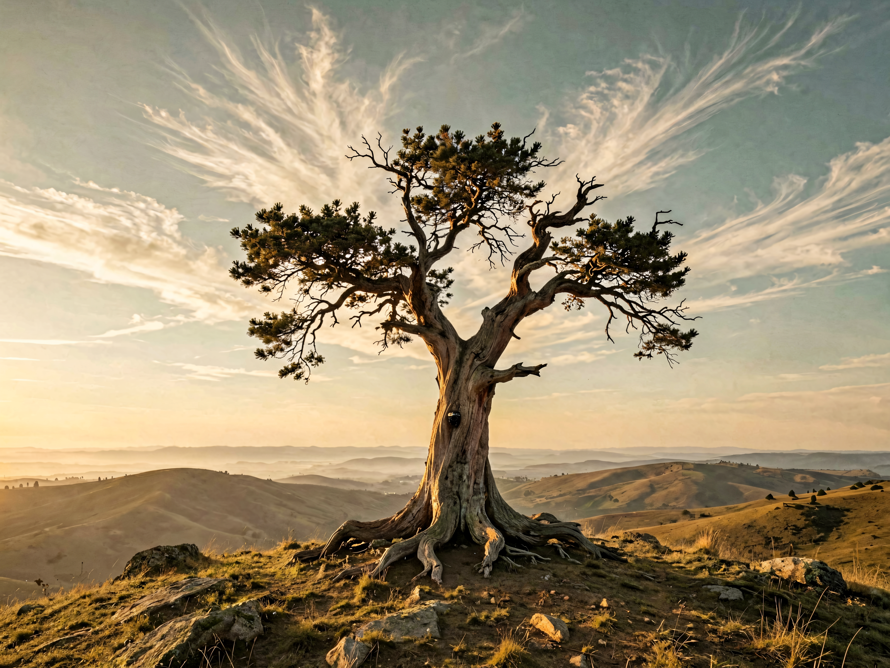
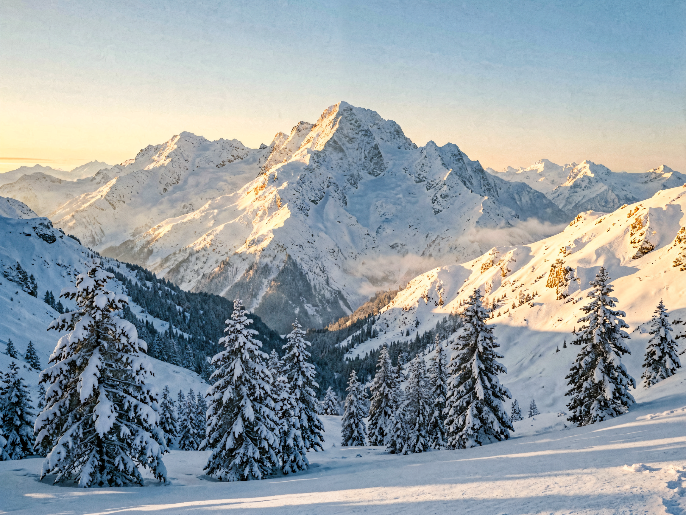

<p align="center">
  
</p>

<p align="center">
  <strong>English</strong> · <a href="README.zh.md">中文</a>
</p>

<h1 align="center">🎨 OpenAgnes-Image</h1>

<p align="center">
  <b>OpenCode + Agnes Image 2.1 Flash = Free article illustration generation, zero cost</b><br>
  Powered by DeepSeek · Driven by Agnes AI API
</p>

<p align="center">
  
  
  
</p>

---

`OpenAgnes-Image` is a skill designed for [OpenCode](https://opencode.ai). It calls the free Agnes AI image generation API (`Agnes-Image-2.1-Flash`) to create high-quality illustrations, covers, and visual assets — all through natural language in OpenCode.

**Completely free.** No credit card required. No trial credits needed.

---

## ✨ Core Features

- **🧠 Self-planning agent** — The built-in free model (e.g. `DeepSeek V4 Flash Free`) understands your request, plans parameters, and optimizes prompts autonomously
- **🎨 Professional generation** — Agnes `Image-2.1-Flash` handles the actual image generation, supporting up to 4K output
- **💬 Natural interaction** — Describe what you want in everyday language; the agent guides you on style, color, composition
- **📁 Auto-save** — Generated images are saved to your project root automatically
- **🔄 Audit & iterate** — Post-generation audit with up to 3 refinement cycles

---

## 🆓 Why It's Free

| Stage | Service | Cost |
|---|---|---|
| **Requirement understanding & planning** | OpenCode built-in free model | **Free**, no API key needed |
| **Image generation** | Agnes `Image-2.1-Flash` API | **Free**, indefinitely open |

> Agnes AI has been offering its core multimodal API to developers worldwide for free since June 1, 2026.

---

## 📥 How to Download

Clone the repository to your local machine:

```bash
git clone https://github.com/VirtualTests1/OpenAgnes-Image.git
```

Or download the ZIP archive from [GitHub](https://github.com/VirtualTests1/OpenAgnes-Image).

Then place the `OpenAgnes-Image` folder into OpenCode's skills directory.

Or simply tell OpenCode:

> 请读取 https://github.com/VirtualTests1/OpenAgnes-Image 这个仓库，安装 openagnes-image 技能，并完成所有相关配置。

OpenCode will automatically clone the repository, install the skill, and complete the setup for you.

---

## 🚀 Quick Start

### Step 1: Get an Agnes API Key

1. Go to [Agnes API Platform](https://platform.agnes-ai.com/)
2. Register and log in
3. Navigate to **API Keys** in the left menu
4. Click **Create New Key**, name it, and **copy the generated key** (e.g., `sk-xxx...`)

> ⚠️ Agnes **Agent Platform** and **API Platform** are separate registrations. You must register on the **API Platform** (`platform.agnes-ai.com`).

### Step 2: Configure the API Key

1. Navigate to the `OpenAgnes-Image` skill directory (where `SKILL.md` lives)
2. Find **`.env.example`** and rename it to **`.env`**
3. Open `.env` and replace `你的API密钥` with your actual Agnes API Key

```
AGNES_API_KEY=sk-your-key-here
```

### Step 3: Load in OpenCode

1. Place the `OpenAgnes-Image` folder in OpenCode's skills directory:
   - Global: `~/.config/opencode/skills/OpenAgnes-Image/`
   - Project-level: `.opencode/skills/OpenAgnes-Image/`
2. Restart OpenCode or type `/reload`

---

## 💬 Usage Examples

```
Generate an article illustration about "AI assistant helping a designer complete creative work"
```

The skill activates automatically and walks you through:
1. Style selection (Real Photo / Anime / Watercolor / Cyberpunk…)
2. Color tone (Warm / Cool / Vivid…)
3. Aspect ratio (16:9 / 1:1 / 9:16 / 4:3…)
4. Generation → audit → delivery

**Supported ratios:** `1:1` `3:4` `4:3` `16:9` `9:16` `2:3` `3:2` `21:9`

### Interaction Depth

The agent adapts to your request's complexity:

| Request type | Example | Behavior |
|---|---|---|
| **Simple** (≥4 params clear) | "Cyberpunk city night, portrait wallpaper" | Extract → generate directly |
| **Guided** (2-3 params clear) | "Seaside sunset for article" | Ask only missing params |
| **Structured** (<20 chars) | "Generate a nice image" | Broad → narrow → generate |
| **Autonomy** | "You decide" | Full creative authority |

---

## 🖼️ Showcase

| Prompt | Mode | Result |
|--------|------|--------|
| Mountain landscape, mist, watercolor style | Autonomy |  |
| Solitary tree, vast grassland, sunset | Autonomy |  |
| Snow village, quiet winter, realistic | Autonomy |  |
| A cat with a boss attitude | Autonomy |  |

---

## 📁 Project Structure

```
OpenAgnes-Image/
├── SKILL.md                  # Skill definition (core logic)
├── README.md                 # English documentation
├── README.zh.md              # Chinese documentation
├── .env.example              # API key template
├── .gitignore
├── scripts/
│   ├── generate.py           # Agnes API caller
│   ├── preferences.py        # User preference cache
│   └── ab_generate.py        # A/B prompt variant generator
├── references/
│   ├── styles.md             # 12 style templates + prompt rules
│   ├── scenes.md             # 18 scene-to-style mappings
│   ├── quality-bank.md       # Quality vocabulary bank
│   └── ratios.md             # Aspect ratio / size reference
└── docs/images/              # Showcase images
```

---

## ⚙️ Requirements

- **OpenCode** (any version)
- **Agnes API Key** from [Agnes API Platform](https://platform.agnes-ai.com/)
- **Network** access to `apihub.agnes-ai.com`

---

## 📝 Notes

- This skill is a community project, not affiliated with the official OpenCode team
- Agnes API is currently free; check official announcements for future policy changes
- Generation speed depends on network and API service status (typically seconds to tens of seconds)

---

## 🔗 Links

- [OpenCode Website](https://opencode.ai)
- [Agnes API Platform](https://platform.agnes-ai.com/)
- [Agnes Image 2.1 Flash Docs](https://agnes-ai.com/zh-Hans/docs/agnes-image-21-flash)

---

## 📄 License

MIT
