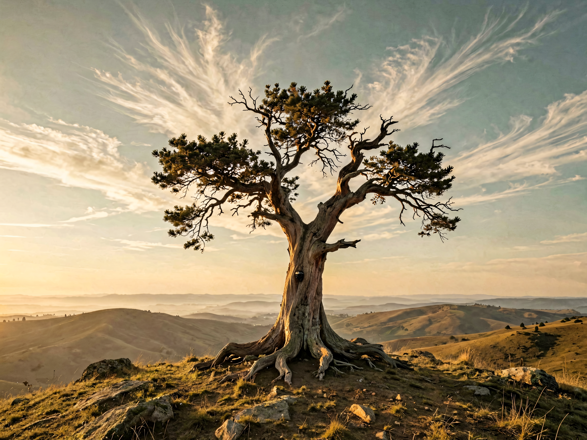
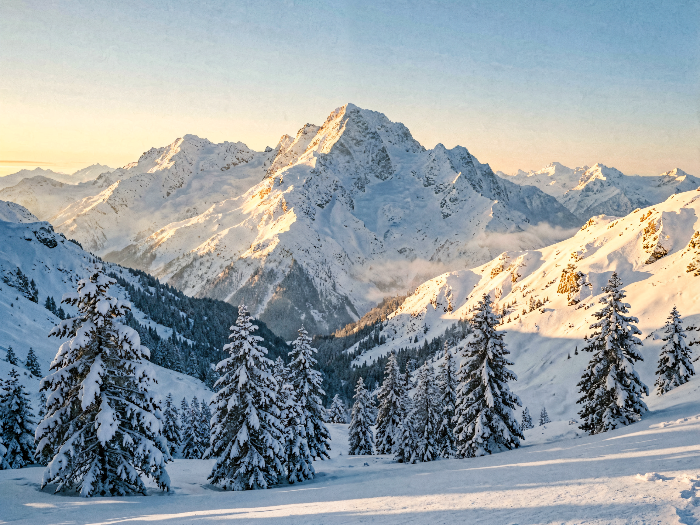

<p align="center">
  
</p>

<p align="center">
  <a href="README.md">English</a> · <strong>中文</strong>
</p>

<h1 align="center">🎨 OpenAgnes-Image</h1>

<p align="center">
  <b>OpenCode + Agnes Image 2.1 Flash = 零成本、全免费的文章配图生成方案</b><br>
  DeepSeek 驱动 · Agnes AI API 引擎
</p>

<p align="center">
  
  
  
</p>

---

`OpenAgnes-Image` 是一个专为 [OpenCode](https://opencode.ai) 设计的技能（Skill），通过调用 Agnes AI 的免费图片生成 API（`Agnes-Image-2.1-Flash`），让你在 OpenCode 中直接用自然语言生成高质量的文章配图、插图、封面图等视觉素材。

整个过程 **完全免费**，无需绑定信用卡，无需申请试用额度。

---

## ✨ 核心特性

- **🧠 智能规划**：OpenCode 内置的免费模型（如 `DeepSeek V4 Flash Free`）负责理解你的需求、规划参数、优化提示词，自主决策执行节奏
- **🎨 专业生图**：Agnes `Image-2.1-Flash` 模型负责实际生成图片，支持 4K 高清输出
- **💬 自然交互**：你只需用日常语言描述想要的图片，AI 会引导你完善风格、色调、构图等细节
- **📁 自动保存**：生成的图片自动保存到当前项目目录，无需手动处理
- **🔄 审计迭代**：生成后自动审计，不满意可一键调整重绘，最多 3 次迭代

---

## 🆓 完全免费的底气

这套方案之所以 **完全免费**，是因为两个环节都不收费：

| 环节 | 使用的服务 | 费用 |
| :--- | :--- | :--- |
| **需求理解与规划** | OpenCode 内置的 `DeepSeek V4 Flash Free` 模型 | **免费**，无需 API Key |
| **图片生成** | Agnes `Image-2.1-Flash` API | **免费**，无限期开放 |

> Agnes AI 自 2026 年 6 月 1 日起，面向全球开发者无限期免费开放其核心多模态 API。

---

## 📥 如何获取本技能

将仓库克隆到本地：

```bash
git clone https://github.com/VirtualTests1/OpenAgnes-Image.git
```

或从 [GitHub](https://github.com/VirtualTests1/OpenAgnes-Image) 下载 ZIP 压缩包。

然后将 `OpenAgnes-Image` 文件夹放入 OpenCode 的技能目录即可。

或直接在 OpenCode 中执行以下提示词：

> 请读取 https://github.com/VirtualTests1/OpenAgnes-Image 这个仓库，安装 openagnes-image 技能，并完成所有相关配置。

OpenCode 会自动完成仓库克隆、技能安装和全部配置。

---

## 🚀 快速开始

### 第一步：获取 Agnes API Key

1. 打开 [Agnes API 平台](https://platform.agnes-ai.com/)
2. 注册并登录账号
3. 在左侧菜单找到「**API 密钥**」或「**API Keys**」
4. 点击「**创建新的密钥**」（Create New Key）
5. 随意命名，点击确认后**复制生成的 API Key**（形如 `sk-xxx...`）

> ⚠️ **注意**：Agnes 的 **Agent 平台** 和 **API 平台** 是独立注册的。请务必在 **API 平台**（`platform.agnes-ai.com`）注册并创建密钥，而非 Agent 平台。

### 第二步：配置 API Key

1. 进入 `OpenAgnes-Image` 技能所在的文件夹（即 `SKILL.md` 所在的目录）
2. 找到名为 **`.env.example`** 的文件，将其重命名为 **`.env`**
3. 用文本编辑器打开 `.env` 文件，将 `你的API密钥` 替换为你的实际 API Key

```
AGNES_API_KEY=sk-你的密钥
```

### 第三步：在 OpenCode 中加载技能

1. 将 `OpenAgnes-Image` 技能文件夹放置到 OpenCode 的技能目录下：
   - 全局：`~/.config/opencode/skills/OpenAgnes-Image/`
   - 或项目级：`.opencode/skills/OpenAgnes-Image/`
2. 重启 OpenCode，或在对话框中输入 `/reload` 加载技能

---

## 💬 使用示例

在 OpenCode 对话框中输入以下指令：

```
帮我生成一张文章配图，主题是"人工智能助手正在帮助设计师完成创意工作"
```

技能会自动激活，并根据需求复杂度选择交互深度：

| 需求类型 | 示例 | 行为 |
|---|---|---|
| **简单**（≥4 个参数明确） | "赛博朋克城市夜景，竖屏壁纸" | 提取参数 → 直接生成，不问多余问题 |
| **中等**（2-3 个参数明确） | "海边日落的配图" | 只问缺失参数 → 生成 |
| **复杂**（<20 字） | "帮我生成一张好看的图片" | 宽泛提问 → 逐步缩窄 → 生成 |
| **自主** | "随便生成一张" / "不指定，由模型自行规划" | 完全创作自主权，使用内置默认值 |

**支持多种宽高比**：1:1、3:4、4:3、16:9、9:16、2:3、3:2、21:9

---

## 🖼️ 效果展示

| 提示词 | 模式 | 结果 |
|--------|------|------|
| 山水画，雾气缭绕，水墨风格 | 自行规划 |  |
| 特立独行的树，广袤草原，日落 | 自行规划 |  |
| 雪景，安静的山村，写实风格 | 自行规划 |  |
| 一只猫，BOSS 范儿 | 自行规划 |  |

---

## 📁 项目结构

```
OpenAgnes-Image/
├── SKILL.md                  # 技能定义文件（核心逻辑）
├── README.md                 # 英文说明
├── README.zh.md              # 中文说明（本文件）
├── .env.example              # API Key 模板
├── .gitignore
├── scripts/
│   ├── generate.py           # Agnes API 调用脚本
│   ├── preferences.py        # 用户偏好缓存
│   └── ab_generate.py        # A/B 测试生成器
├── references/
│   ├── styles.md             # 12 种风格模板 + 提示词规则
│   ├── scenes.md             # 18 个场景到风格的映射
│   ├── quality-bank.md       # 质量增强词汇库
│   └── ratios.md             # 宽高比 / 尺寸参考表
└── docs/images/              # 示例图片
```

---

## ⚙️ 环境要求

- **OpenCode**：任意版本（推荐使用内置免费模型）
- **Agnes API Key**：从 [Agnes API 平台](https://platform.agnes-ai.com/) 获取
- **网络**：需能访问 `apihub.agnes-ai.com`

---

## 📝 注意事项

- 本技能非 OpenCode 官方团队开发，与 OpenCode 团队无隶属关系
- Agnes API 目前完全免费，未来若有政策变化请以官方公告为准
- 图片生成速度受网络和 API 服务状态影响，通常需要数秒到数十秒

---

## 🔗 相关链接

- [OpenCode 官网](https://opencode.ai)
- [Agnes API 平台](https://platform.agnes-ai.com/)
- [Agnes Image 2.1 Flash 文档](https://agnes-ai.com/zh-Hans/docs/agnes-image-21-flash)

---

## 📄 许可证

MIT
