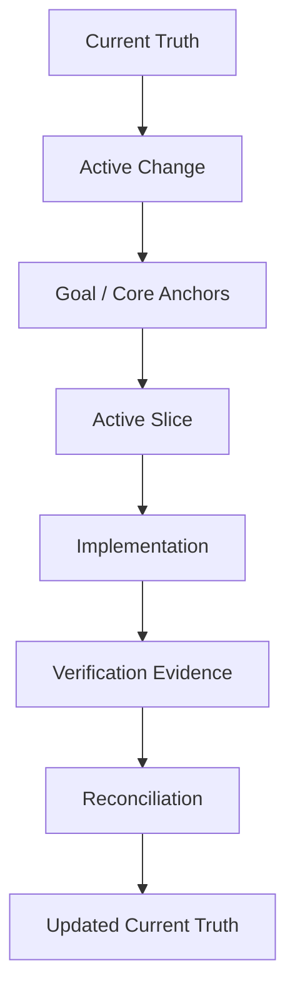

# Project Anchor

[English](README.md) | [简体中文](README.zh-CN.md)

> Keep AI coding agents aligned from intent to implementation.

A lightweight project governance skill that keeps AI coding agents aligned with project truth, change intent, execution focus, and verification evidence.

| Predictable failure | Lightweight anchor |
|---|---|
| Intent drift | `Goal` + `Core Anchors` |
| Working-set overload | `Active Slice` + `Deferred` |
| Uncontrolled retry | `Diagnosis` + `Do Not Repeat` |
| Premature completion | `Verification Evidence` + `Completion Gate` |

## Why this exists

Long-running AI coding tasks tend to fail in predictable ways. The original requirement gets diluted, too many concerns compete for attention, a failed approach is retried without learning, or green tests are mistaken for actual completion.

Project Anchor does not solve these problems by adding another agent reasoning protocol. It adds a thin, project-level governance layer around long-running AI coding work:

- authoritative project truth stays separate from history and in-progress plans;
- one active change describes the intended future state;
- a compact execution state protects the goal and current focus;
- verification records what was actually proven;
- reconciliation brings delivered behavior back into current truth.

## How it works



The convergence target is:

```text
Intent = Spec = Implementation = Tests/Verification = Current Truth
```

Project Anchor uses the lightest process that protects the work. A typo or obvious local fix stays:

```text
understand -> edit -> test -> done
```

A significant change can use:

```text
proposal -> spec -> design -> tasks -> implementation
         -> verification -> reconciliation -> current truth -> archive
```

## Quick start

### Install

`SKILL.md` is the skill entry point. Clone or download this repository, then copy the whole directory into a skills location supported by your coding agent.

Common Agent Skills locations are:

```text
# Repository scoped
<repo>/.agents/skills/project-anchor/

# User scoped
$HOME/.agents/skills/project-anchor/
```

On Windows, the user-scoped path is commonly:

```text
%USERPROFILE%\.agents\skills\project-anchor\
```

Skill directories differ between clients and versions. Use your client's documented location when it differs. If your agent has no Agent Skills loader, ask it to read `SKILL.md` as project instructions and keep `references/`, `assets/`, and `scripts/` available beside it.

The core workflow is vendor-neutral. It can be used with Agent Skills-capable AI agents and coding agents, including environments around Codex, Claude Code, GitHub Copilot, and OpenCode, subject to each client's current skill-loading rules.

### Invoke

For clients that support named skills:

```text
$project-anchor audit this repository and establish the lightest useful governance structure.
```

Otherwise, ask the agent to read `SKILL.md` and apply the Project Anchor workflow.

### Optional helper CLI

The helper uses only the Python standard library and never overwrites existing files.

```bash
# Create missing governance structure
python scripts/governance.py init --root <repo> --profile generic

# Start a significant change
python scripts/governance.py new-change add-long-term-memory --root <repo>

# Create the next numbered ADR
python scripts/governance.py new-adr "Separate session key from session id" --root <repo>

# Validate structure
python scripts/governance.py validate --root <repo>
```

Available profiles: `generic`, `agent`, `python`, and `java`.

## Core concepts

### Current Truth

The repository's present-tense truth is separated by role:

```text
AGENTS.md              small persistent agent guidance and routing
docs/product/          scope and product boundaries
docs/specs/            observable behavior promised now
docs/architecture/     how the system works now
docs/invariants/       rules that must remain true
docs/decisions/        durable architecture rationale (ADRs)
docs/changes/active/   proposed future state
docs/changes/archive/  historical change context
Tests / CI             executable enforcement
Git                    ordinary code history
```

The important boundary is:

```text
Current truth != history != in-progress execution state
```

### Goal and Core Anchors

`Goal` points to the intended outcome. `Core Anchors` link to the small set of requirements, constraints, invariants, boundaries, or ADRs that must remain true. Execution state references authoritative facts instead of duplicating them.

### Active Slice and Deferred

Keep one coherent `Active Slice` in focus. Park useful later work under `Deferred` instead of switching context mid-slice. There are no arbitrary limits on files or subtasks; split only when competing concerns are causing loss of focus.

### Failed-attempt learning

Record only failures that change the next decision:

```text
Attempt: <what was tried>
Result: <observable failure>
Diagnosis: <why it failed>
Do not repeat: <ruled-out approach or assumption>
Next: <changed approach>
```

### Verification Evidence and Completion Gate

Connect each high-signal verifier to what it covers:

```text
Verifier: <test / command / review>
Covers: <requirement / invariant / failure mode>
Result: <PASS|FAIL + decision-relevant note>
```

Code-complete or green tests are not enough. A significant change closes only when required scope is accounted for, important behavior has meaningful coverage, correctness-affecting questions are resolved, and reconciliation is complete.

## Example

[`examples/significant-change/`](examples/significant-change/) shows a compact idempotent-job-retry change:

```text
proposal.md   -> goal, scope, non-goals, constraints
spec.md       -> observable requirements and acceptance criteria
design.md     -> implementation approach and trade-offs
tasks.md      -> Goal, Core Anchors, Active Slice, Deferred,
                 failed-attempt diagnosis, and verification evidence
```

The example is intentionally small. It shows how the artifacts relate without pretending to be a production system.

## When to use it

Use Project Anchor when work is long-running, interrupted/resumed, multi-step, failure-prone, or at meaningful risk of drift—especially when a feature or refactor changes behavior, APIs, data, lifecycle, permissions, concurrency, migrations, or architecture.

Do not start a full active-change workflow for a typo, one-line configuration edit, simple rename, routine explanation, or obvious local fix.

## What it is not

Project Anchor is not:

- a project management suite;
- an agent runtime;
- a reasoning-trace or chain-of-thought framework;
- a per-loop controller;
- a knowledge graph;
- an autonomous planning engine;
- a replacement for Git;
- a replacement for tests;
- mandatory ceremony for every change.

It is only **a thin governance layer around long-running AI coding work**.

## Context engineering without context bloat

Project Anchor applies context engineering at the repository level: keep facts in authoritative documents, link instead of duplicate, separate current truth from history, and refresh execution state only at meaningful seams. This supports disciplined AI coding and vibe coding without turning every model or tool call into a checkpoint.

## Repository layout

```text
project-anchor/
├── SKILL.md
├── README.md
├── README.zh-CN.md
├── RELEASE_NOTES.md
├── LICENSE
├── CONTRIBUTING.md
├── assets/templates/
├── references/
├── scripts/governance.py
├── examples/significant-change/
└── evals/prompts.csv
```

## Compatibility and migration

Existing repositories do not need a governance migration. Preserve valid documentation and adopt only the pieces that add value. Existing `Current` execution fields can be treated as `Active Slice`; do not rewrite already-valid documentation just to adopt this skill.

## Contributing

Keep contributions aligned with the core constraint: **lightweight project governance, not workflow expansion**. See [`CONTRIBUTING.md`](CONTRIBUTING.md).

## License and status

MIT. See [`LICENSE`](LICENSE).

Project Anchor is an independent, vendor-neutral community project. It is not affiliated with or endorsed by any AI platform or model provider.
