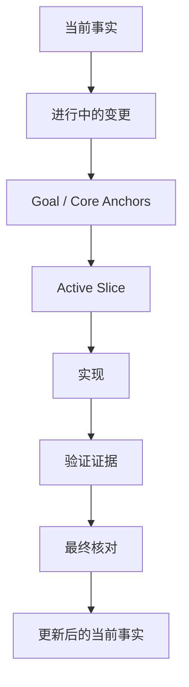

# Project Anchor

[English](README.md) | [简体中文](README.zh-CN.md)

> 让 AI 编码智能体从需求意图到实现交付始终保持一致。

一个面向 AI Coding Agent 的轻量级项目治理 Skill，让长期开发任务始终锚定项目事实、变更意图、执行重点和验证证据。

| 可预见的失败模式 | 轻量级锚点 |
|---|---|
| 意图漂移（Intent drift） | `Goal` + `Core Anchors` |
| 工作集过载（Working-set overload） | `Active Slice` + `Deferred` |
| 失控重试（Uncontrolled retry） | `Diagnosis` + `Do Not Repeat` |
| 过早完成（Premature completion） | `Verification Evidence` + `Completion Gate` |

## 为什么需要它

长期运行的 AI 编码任务往往以几种可预见的方式失败：原始需求逐渐被稀释，太多事项同时争夺注意力，失败方案在没有吸取经验的情况下被重复尝试，或者仅凭测试通过就过早宣布完成。

Project Anchor 不通过增加更多智能体推理协议来解决这些问题。它只在长期 AI 编码工作外围增加一层很薄的项目级治理：

- 将权威项目事实与历史、进行中的计划分开；
- 用一项进行中的变更描述预期未来状态；
- 用精简执行状态保护目标和当前焦点；
- 用验证证据说明实际证明了什么；
- 通过最终核对将已交付行为更新为当前事实。

## 工作原理



核心收敛目标是：

```text
意图 = 规格 = 实现 = 测试/验证 = 当前事实
```

Project Anchor 始终采用足以保护工作的最轻流程。修正拼写或完成明确的局部修改时，流程仍然只是：

```text
理解 -> 修改 -> 测试 -> 完成
```

重要变更可以使用：

```text
提案 -> 规格 -> 设计 -> 任务 -> 实现
     -> 验证 -> 核对 -> 当前事实 -> 归档
```

## 快速开始

### 安装

`SKILL.md` 是技能入口。克隆或下载本仓库，然后将整个目录复制到你的编码智能体支持的技能位置。

常见的 Agent Skills 目录结构是：

```text
# 仓库级
<repo>/.agents/skills/project-anchor/

# 用户级
$HOME/.agents/skills/project-anchor/
```

Windows 上常见的用户级位置是：

```text
%USERPROFILE%\.agents\skills\project-anchor\
```

不同客户端及其不同版本使用的技能目录可能不同，请在不一致时以客户端文档为准。如果智能体没有 Agent Skills 加载机制，可以要求它将 `SKILL.md` 作为项目指令读取，并将 `references/`、`assets/` 和 `scripts/` 保留在旁边供其访问。

核心工作流与厂商无关，可用于支持 Agent Skills 的 AI agents 和 coding agents，包括 Codex、Claude Code、GitHub Copilot 和 OpenCode 等生态环境；具体加载规则以各客户端当前版本为准。

### 调用

对于支持按名称调用技能的客户端：

```text
$project-anchor 审计此仓库，并建立满足需要的最轻量治理结构。
```

否则，直接要求智能体读取 `SKILL.md` 并应用 Project Anchor 工作流。

### 可选辅助 CLI

辅助工具仅使用 Python 标准库，并且绝不会覆盖已有文件。

```bash
# 创建缺失的治理结构
python scripts/governance.py init --root <repo> --profile generic

# 启动一项重要变更
python scripts/governance.py new-change add-long-term-memory --root <repo>

# 创建下一个带编号的 ADR
python scripts/governance.py new-adr "Separate session key from session id" --root <repo>

# 验证结构
python scripts/governance.py validate --root <repo>
```

可用配置：`generic`、`agent`、`python` 和 `java`。

## 核心概念

### 当前事实

仓库中使用不同文档角色表示现在真实成立的事实：

```text
AGENTS.md              精简、持久的智能体指导和文档导航
docs/product/          范围和产品边界
docs/specs/            当前承诺的可观察行为
docs/architecture/     系统当前如何工作
docs/invariants/       必须始终成立的规则
docs/decisions/        持久的架构决策依据（ADR）
docs/changes/active/   提议的未来状态
docs/changes/archive/  历史变更上下文
Tests / CI             可执行约束
Git                    常规代码历史
```

最重要的边界是：

```text
当前事实 != 历史 != 进行中的执行状态
```

### Goal 和 Core Anchors

`Goal` 指向预期结果；`Core Anchors` 链接到必须保持成立的少量需求、约束、不变量、边界或 ADR。执行状态引用权威事实，而不是复制事实。

### Active Slice 和 Deferred

一次只聚焦于一个连贯的 `Active Slice`。把以后有价值的工作放入 `Deferred`，不要在当前工作片段中途切换上下文。这里没有任意的文件数或子任务数限制；只有互相竞争的事项导致失焦时才需要拆分。

### 从失败尝试中学习

只记录会影响下一步决策的失败：

```text
Attempt: <尝试了什么>
Result: <可观察到的失败>
Diagnosis: <失败原因>
Do not repeat: <已排除的方案或假设>
Next: <调整后的方案>
```

### Verification Evidence 和 Completion Gate

将每个高信号验证方式与其覆盖内容关联起来：

```text
Verifier: <测试 / 命令 / 审查>
Covers: <需求 / 不变量 / 失败模式>
Result: <PASS|FAIL + 与决策相关的说明>
```

代码写完或测试通过还不够。只有当要求的范围已经落实、重要行为获得有效验证、影响正确性的问题得到解决，并且最终核对完成后，重要变更才能结束。

## 示例

[`examples/significant-change/`](examples/significant-change/) 展示了一项精简的“任务重试幂等性”变更：

```text
proposal.md   -> 目标、范围、非目标、约束
spec.md       -> 可观察需求和验收条件
design.md     -> 实现方案和权衡
tasks.md      -> Goal、Core Anchors、Active Slice、Deferred、
                 失败尝试诊断和验证证据
```

示例有意保持精简，只展示各文档之间的关系，并不假装自己是完整的生产系统。

## 何时使用

当工作耗时较长、会中断后恢复、包含多个步骤、容易失败或存在明显漂移风险时，适合使用 Project Anchor；功能或重构会改变行为、API、数据、生命周期、权限、并发、迁移或架构时尤其适用。

修正拼写、修改一行配置、简单重命名、常规解释或明确的局部修复，不应启动完整的 Active Change 工作流。

## 它不是什么

Project Anchor 不是：

- 项目管理套件；
- 智能体运行时；
- 推理轨迹或思维链框架；
- 每轮循环控制器；
- 知识图谱；
- 自主规划引擎；
- Git 的替代品；
- 测试的替代品；
- 每次修改都必须执行的流程仪式。

它只是：**长期 AI 编码工作外围的一层轻量治理。**

## 不造成上下文膨胀的 Context Engineering

Project Anchor 在仓库层面应用 Context Engineering：把事实放在权威文档中，以链接代替复制，区分当前事实与历史，并且只在有意义的工作边界刷新执行状态。它支持更有纪律的 AI coding 和 vibe coding，但不会把每次模型或工具调用变成检查点。

## 仓库结构

```text
project-anchor/
├── SKILL.md
├── README.md
├── README.zh-CN.md
├── RELEASE_NOTES.md
├── LICENSE
├── CONTRIBUTING.md
├── assets/templates/
├── references/
├── scripts/governance.py
├── examples/significant-change/
└── evals/prompts.csv
```

## 兼容性和迁移

现有仓库不需要进行治理迁移。保留有效文档，只采用能够带来价值的部分。已有的 `Current` 执行字段可以视为 `Active Slice`；不要为了采用本技能而重写原本有效的文档。

## 参与贡献

请让贡献始终符合核心约束：**轻量项目治理，而不是扩张工作流程**。详情请参阅 [`CONTRIBUTING.md`](CONTRIBUTING.md)。

## 许可证和项目状态

采用 MIT 许可证。详情请参阅 [`LICENSE`](LICENSE)。

Project Anchor 是独立、厂商中立的社区项目，与任何 AI 平台或模型提供商均不存在隶属关系，也未获得其官方背书。
