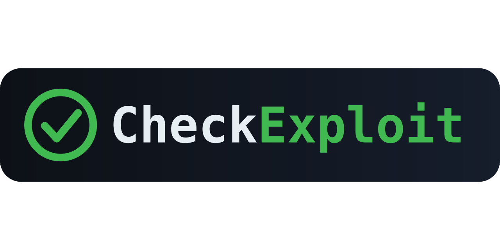

**Scanners flag CVEs. CheckExploit proves which ones actually reach your code.**

Give it a repo — it finds flagged vulnerabilities, runs real exploits against your code in an isolated sandbox, and tells you what's exploitable and what's safe. If something is exploitable, it writes and verifies the fix.

## How it works

CheckExploit runs entirely inside Docker containers with `--network none` — your host never executes untrusted code.

The flow has two parts: a mechanical driver (Python) that clones, scans, and builds images, and an LLM agent that generates PoCs, runs exploits, judges verdicts, and produces patches.

```
User invokes /checkexploit
        │
        ▼
┌─────────────────────────────────────────────────────────┐
│  agent/orchestrate.py (Python — mechanical)             │
│                                                         │
│  1. Clone or resolve repo (local path or GitHub URL)    │
│  2. agent/scan.py — query OSV.dev for every package     │
│     → run reachability analysis per CVE                 │
│     → bucket as to_test / not_reachable                 │
│  3. agent/build_image.py — build ONE image per          │
│     ecosystem present in the repo:                      │
│     • python (python:3.11-slim + pip install)           │
│     • node   (node:20-slim   + npm install)             │
│     (SHA-cached: ce-sandbox:<repo>-<sha>-<runtime>)     │
│  4. Write data/output/<repo>/triage.json                │
│     (includes triage['images'] for per-CVE routing)     │
└─────────────────────────────────────────────────────────┘
        │
        ▼
┌─────────────────────────────────────────────────────────┐
│  CheckExploit LLM agent (the brain)                     │
│                                                         │
│  For each CVE in triage['to_test']:                     │
│    • Pick image = triage['images'][<ecosystem>]         │
│    • Read reachability.json (call sites)                │
│    • Generate a PoC script (HTTP request)               │
│    • sandbox_write /srv/poc.py                          │
│    • sandbox_exec — start service, run PoC              │
│    • sandbox_read /srv/verdict.json                     │
│    • Judge: was that really an exploit?                 │
│    • If exploitable:                                    │
│        write patch → sandbox_write → restart → re-run   │
│        → post-patch verdict must be non-exploitable     │
│    • sandbox_stop                                       │
│                                                         │
│  Write report.md + report.json                          │
└─────────────────────────────────────────────────────────┘
```

Each CVE gets its own container — failures on CVE-1 cannot bleed into CVE-2. Each ecosystem gets its own image — npm CVEs run in a real node:20-slim container with the package installed, not in a python:3.11-slim sleep-hold.

## What you get

A report with three buckets:

- **Exploitable** — CVE reaches attacker-controlled input in your code. Includes live HTTP evidence and a verified remediation patch.
- **Not exploitable** — CVE was tested and couldn't be triggered through your attack surface.
- **Not reachable** — static analysis proved the vulnerable code path is never called from your surface.

## Prerequisites

| Requirement | Description |
|-------------|-------------|
| Python 3.11+ | Required for the mechanical driver |
| Docker | Required for the sandbox (builds and runs exploit containers) |
| Internet access | To query CVE.org and OSV for vulnerability data |
| Same network namespace | Cloud-hosted harnesses cannot reach `localhost` |
| MCP-compatible client | Claude Code, Codex, or OpenCode must support Streamable HTTP MCP |

## Installation for Each Harness

Users can install CheckExploit into **Claude Code, Codex, or OpenCode** via the `--setup` flag. Choose one harness; the installer copies the skill, merges MCP config, and prints usage guidance. The `--setup` run already writes both MCP entries; the fragments below are the manual equivalent — skip them if the installer succeeded.

### 1. Claude Code

**Prerequisites:**
- Python 3.11+ (required for the mechanical driver)
- Outbound internet access to CVE.org and OSV
- The harness and server must run on the same machine/network namespace (cloud-hosted harnesses cannot reach localhost)

**Steps:**

1. **Install the skill**
   ```bash
   bash scripts/install.sh --setup claude-code
   ```

2. **Configure the MCP servers**
   - In your project, add the MCP server configuration to `.mcp.json`:
     ```json
     {
       "mcpServers": {
         "local-sandbox": {
           "type": "http",
           "url": "http://127.0.0.1:8081/mcp"
         },
         "cve-feed": {
           "type": "http",
           "url": "http://127.0.0.1:8091/mcp"
         }
       }
     }
     ```
   - Alternatively, use the native CLI (project-scoped):
     ```bash
     claude mcp add --transport http --scope project local-sandbox http://127.0.0.1:8081/mcp
     claude mcp add --transport http --scope project cve-feed http://127.0.0.1:8091/mcp
     ```

3. **Start both MCP servers**
   ```bash
   python3 agent/mcp/local_sandbox_server.py &   # :8081
   python3 agent/mcp/cve_feed_server.py &         # :8091
   ```

4. **Verify connectivity**
   - Check that `local-sandbox` and `cve-feed` connect via `/mcp`
   - Server health (both should return 200 OK):
     ```bash
     python3 -c "import urllib.request; print(urllib.request.urlopen('http://127.0.0.1:8081/health').status)"
     python3 -c "import urllib.request; print(urllib.request.urlopen('http://127.0.0.1:8091/health').status)"
     ```

### 2. Codex

**Prerequisites:**
- Same as above (Python 3.11+, outbound access to CVE feeds)

**Steps:**

1. **Install the skill**
   ```bash
   bash scripts/install.sh --setup codex
   ```

2. **Configure the MCP servers**
   - Add to `~/.codex/config.toml` (or project-level `.codex/config.toml`):
     ```toml
     [mcp_servers.local-sandbox]
     url = "http://127.0.0.1:8081/mcp"

     [mcp_servers.cve-feed]
     url = "http://127.0.0.1:8091/mcp"
     ```

3. **Start both MCP servers**
   ```bash
   python3 agent/mcp/local_sandbox_server.py &   # :8081
   python3 agent/mcp/cve_feed_server.py &         # :8091
   ```

4. **Verify connectivity**
   - Server health (both should return 200 OK):
     ```bash
     python3 -c "import urllib.request; print(urllib.request.urlopen('http://127.0.0.1:8081/health').status)"
     python3 -c "import urllib.request; print(urllib.request.urlopen('http://127.0.0.1:8091/health').status)"
     ```

### 3. OpenCode

**Prerequisites:**
- Python 3.11+ (mechanical driver)
- Outbound access to CVE.org and OSV
- The harness and server must run on the same machine/network namespace

**Steps:**

1. **Install the skill**
   ```bash
   bash scripts/install.sh --setup opencode
   ```

2. **Configure the MCP servers**
   - Add to `~/.config/opencode/opencode.json`:
     ```json
     {
       "mcp": {
         "local-sandbox": {
           "type": "remote",
           "url": "http://127.0.0.1:8081/mcp"
         },
         "cve-feed": {
           "type": "remote",
           "url": "http://127.0.0.1:8091/mcp"
         }
       }
     }
     ```

3. **Start both MCP servers**
   ```bash
   python3 agent/mcp/local_sandbox_server.py &   # :8081
   python3 agent/mcp/cve_feed_server.py &         # :8091
   ```

4. **Verify connectivity**
   - Server health (both should return 200 OK):
     ```bash
     python3 -c "import urllib.request; print(urllib.request.urlopen('http://127.0.0.1:8081/health').status)"
     python3 -c "import urllib.request; print(urllib.request.urlopen('http://127.0.0.1:8091/health').status)"
     ```

## Running the Full Workflow (Optional)

If you want the full CheckExploit agent (which performs dynamic analysis, generates PoCs, and creates patches), use the no-argument installer:

```bash
bash scripts/install.sh
```

This installs the full skill and MCP configuration for OpenCode (same as `--setup opencode`). Then start the servers and run:

```bash
opencode /checkexploit
```
or

```bash
python3 agent/orchestrate.py <repo-path>
```

To skip the image build and use a pre-built one:

```bash
CE_IMAGE=my-image python3 agent/orchestrate.py /path/to/repo
```

Results are written to `data/output/<repo>/report.md` and `data/output/<repo>/report.json`.

## Key files

| File | Purpose |
|---|---|
| `agent/orchestrate.py` | Mechanical driver — clone, scan, build image, write triage.json |
| `agent/scan.py` | CVE discovery + reachability bucketing (to_test / not_reachable) |
| `agent/build_image.py` | Per-repo Docker image build, SHA-cached, one per ecosystem |
| `agent/exploit.py` | Sandbox harness helper (`run_exploit_for_cve`) |
| `agent/analyzer/reach.py` | Static reachability analysis (dep-pin → call-sites → input trace) |
| `agent/mcp/local_sandbox_server.py` | MCP server — sandbox tools (sandbox_build, sandbox_exec, etc.) |
| `agent/mcp/cve_feed_server.py` | MCP server — CVE tools (cve_get_cve, osv_query_package, etc.) |
| `SKILL.md` | opencode skill (installed via `scripts/install.sh`) |
| `scripts/install.sh` | Idempotent installer — copies skill + MCP config into `~/.config/opencode/` |
| `.opencode/agents/checkexploit.md` | The LLM agent definition |
| `.opencode/command/checkexploit.md` | `/checkexploit` command |

## Example report

```
# CheckExploit Scan Report — `my-repo`

CVEs discovered: 23
CVEs tested: 8
Exploitable: 1
Not exploitable: 7

## Exploitable CVEs

### CVE-2024-21503

- Reason: SQL error in error response
- Request: POST /students/ body=name=test'+OR+'1'='1
- Response: status=500, body=DB error: not enough arguments

Remediation (verified):

cur.execute("INSERT INTO students (name) VALUES (%s)", (name,))
```

## Get started (without opencode)

### 1. Start the MCP servers

```bash
python3 agent/mcp/local_sandbox_server.py &   # sandbox tools: sandbox_build, sandbox_exec, etc.
python3 agent/mcp/cve_feed_server.py &        # CVE tools: cve_get_cve, osv_query_package, etc.
```

### 2. Run the agent

In OpenCode, invoke the `/checkexploit` command:

```
/checkexploit https://github.com/user/repo
/checkexploit .                        # current directory
/checkexploit . --cve CVE-2024-21503  # test one specific CVE
```

Or use the CLI directly for a full scan:

```bash
python3 agent/orchestrate.py /path/to/repo
python3 agent/orchestrate.py https://github.com/user/repo
```

To skip the image build and use a pre-built one:

```bash
CE_IMAGE=my-image python3 agent/orchestrate.py /path/to/repo
```

Results are written to `data/output/<repo>/report.md` and `data/output/<repo>/report.json`.

## FAQ

**Does it run exploits on my host?**
No. Everything runs inside Docker containers with `--network none`. Your machine never executes untrusted code.

**How does it find CVEs?**
It queries OSV.dev at runtime for every package in your `requirements.txt` or lock file. No CVE data is hardcoded. The cve_feed MCP server (port 8091) can also be used to cross-check CVEs against CVE.org.

**Does it work on non-Python repos?**
Yes. As of the multi-ecosystem routing change (PR #93), CheckExploit builds one image per ecosystem present in the repo:
- Repos with `package.json` get a `node:20-slim` image with `npm install` ran.
- Repos with `requirements.txt` / `pyproject.toml` / `Pipfile` get a `python:3.11-slim` image.
- Repos with both get both. Each CVE is routed to the matching image.

TypeScript / yarn / pnpm / monorepos: not yet. Add when a real caller needs it.

**What's the difference between the CLI and the agent?**
The CLI (`agent/orchestrate.py`) handles the deterministic parts: cloning, scanning, building the image, and writing `triage.json`. The LLM agent handles the creative parts: writing PoCs, judging verdicts, and generating patches.

## License

MIT